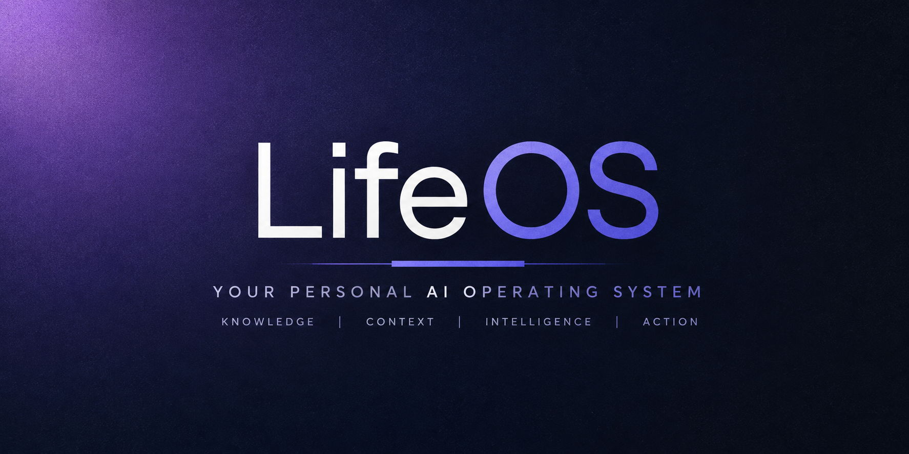

<p align="center">
  
</p>

# LifeOS

> **A personal AI operating system that evolves from document retrieval into personal context, identity, reasoning, and eventually agentic assistance.**

LifeOS is a modular AI system designed to build a progressively richer representation of a person's digital life.

It starts with classical RAG — ingestion, chunking, embeddings, vector retrieval, and reranking — and progressively adds structured knowledge, multimodal understanding, people and identity, and personal context.

---

## Vision

```text
Files
  ↓
Knowledge
  ↓
Structured Data
  ↓
Multimodal Understanding
  ↓
People & Identity
  ↓
Personal Context
  ↓
Entities & Relationships
  ↓
Reasoning
  ↓
Personal Intelligence
  ↓
Agentic Assistance
```

The system is intentionally built incrementally so each layer has a clear responsibility and can be tested independently.

---

## What LifeOS Can Do Today

- Document and file ingestion
- Text chunking and embedding generation
- Persistent ChromaDB vector storage
- Semantic retrieval and reranking
- Filename-aware and hybrid file discovery
- Structured CSV discovery and querying
- LLM-based intent planning
- Deterministic intent execution
- Multimodal/image understanding
- Image visual metadata
- Person/face identity storage and retrieval
- Multimodal candidate resolution
- Persistent personal context
- Typed context such as schedules, routines, preferences, and goals
- Temporal context with validity windows
- Active-context resolution
- Query-relevant context filtering
- Context composition and grouping
- Deterministic context conflict resolution
- Context freshness filtering
- Personal context passed into the existing LLM decision boundary
- Persistent entity and relationship knowledge graph (SQLite)
- Case-insensitive entity lookup and alias resolution
- Automated entity and relationship extraction on document ingestion
- Reindex lifecycle support for entities and relationships
- People identity linking to knowledge graph entities
- Relationship-aware personal context composition
- Grounded relationship evidence integration for reasoning
- Deterministic relationship query planning and tool execution
- Agentic relationship search through bounded AgentRunner
- Unified grounded reasoning boundary across all factual query types
- Deterministic multi-source evidence aggregation across documents, context, relationships, and structured data
- Calibrated confidence scoring incorporating retrieval distance, context freshness, and evidence quality
- Deterministic conflict and contradiction detection for schedules, properties, and relationships
- Deterministic relative-time resolution and temporal expression extraction
- Bounded multi-hop relationship graph traversal with cycle prevention
- Structured reasoning results with explicit separation of grounded facts and inferences

---

## Architecture

LifeOS separates **LLM reasoning/planning** from **deterministic execution**.

```text
                         ┌─────────────────────┐
                         │     User Query      │
                         └──────────┬──────────┘
                                    │
                                    ▼
                         ┌─────────────────────┐
                         │ Intelligence Layer  │
                         │                     │
                         │ LLM → IntentPlan    │
                         └──────────┬──────────┘
                                    │
                                    ▼
                         ┌─────────────────────┐
                         │ Intelligence Router │
                         │ deterministic       │
                         │ dispatch            │
                         └──────────┬──────────┘
                                    │
                 ┌──────────────────┼──────────────────┐
                 ▼                  ▼                  ▼
          Document Search     Structured Query    Multimodal Search
                 │                  │                  │
                 └──────────────────┼──────────────────┘
                                    │
                                    ▼
                         ┌─────────────────────┐
                         │ Retrieval / Context │
                         │ embeddings          │
                         │ ChromaDB            │
                         │ reranking           │
                         │ personal context    │
                         └──────────┬──────────┘
                                    │
                                    ▼
                         ┌─────────────────────┐
                         │     QueryResult     │
                         └─────────────────────┘
```

### Core design principle

> **The LLM decides what the user wants. Python decides how to execute it.**

This keeps database, retrieval, and execution operations deterministic, testable, and extensible.

---

## Retrieval Pipeline

```text
Document
   ↓
Ingestion
   ↓
Chunking
   ↓
Embedding
   ↓
ChromaDB
   ↓
Query Embedding
   ↓
Candidate Retrieval
   ↓
Reranking / Resolution
   ↓
Relevant Evidence
```

Metadata is stored alongside retrieved objects so LifeOS can reason about sources, document types, media types, file paths, people, and other retrieval signals.

---

## Intelligence Pipeline

```text
User Query
    ↓
LLM Planner
    ↓
IntentPlan
    ↓
Intelligence Router
    ↓
Deterministic Tool
    ↓
QueryResult
```

Supported intent categories include:

- File discovery
- Document search
- Structured discovery
- Structured queries
- Multimodal search
- People search
- Schedule queries
- Current-time queries

This allows new capabilities to be added without turning the LLM into an unrestricted execution engine.

---

## Personal Context

LifeOS includes a persistent context layer designed to behave more like personal memory than ordinary document retrieval.

Context can have:

- A key
- A value
- A type
- An update timestamp
- A validity start
- A validity end

Example:

```text
current_class
    value: DBMS
    type: schedule
    valid_from: 08:00
    valid_until: 10:00
```

The context pipeline is:

```text
Stored Context
      ↓
Temporal Validation
      ↓
Active Context
      ↓
Query Relevance
      ↓
Context Composition
      ↓
Conflict Resolution
      ↓
Freshness Filtering
      ↓
LLM Decision Boundary
```

This provides the foundation for interactions such as:

> "Which class do I have now?"

where the system can use currently valid personal context instead of requiring the user to restate it.

---

## Multimodal Understanding

```text
Image
  ↓
Vision Analysis
  ↓
Visual Metadata
  ↓
Embedding
  ↓
Vector Storage
  ↓
Multimodal Retrieval
  ↓
Candidate Resolution
```

People metadata can also be associated with image-derived knowledge, creating a foundation for identity-aware retrieval.

---

## People & Identity

The identity layer provides persistent storage for people and face embeddings.

```text
Person
 ├── person_id
 ├── label
 ├── status
 └── face embeddings
```

This forms the foundation for future identity-aware reasoning across documents, images, events, and relationships.

---

## Agentic LifeOS (Phase 10)

LifeOS incorporates a bounded agentic execution layer built on top of its existing deterministic capabilities.

```text
User Query
    ↓
AgentRunner (bounded loop, configurable max_steps)
    ↓
AgentPlanner (LLM / fake planner decides WHAT)
    ↓
AgentDecision (action: tool, finish, fail)
    ↓
AgentExecutor (validates tool & arguments schema)
    ↓
ToolRegistry (allowlisted registered tools)
    ↓
Deterministic Tool Execution
    ↓
ToolCall & Evidence recorded in AgentState
    ↓
Next step decision if needed (or termination)
    ↓
QueryResult Adapter / Grounded Final Answer
```

### Key Principles

- **Bounded Execution**: Loop execution is strictly bounded by explicit `max_steps` to guarantee no infinite loops or uncontrolled recursion.
- **Planner / Executor Separation**: The LLM proposes actions; Python validates schemas and executes registered tools. The model is never granted direct shell, filesystem, or Python execution privileges.
- **Allowlisted Tool Registry**: Tools require typed Pydantic input schemas and registered deterministic execution contracts (`current_time`, `document_search`, `file_discovery`).
- **State Machine & Auditability**: `AgentState` tracks explicit lifecycle transitions (`pending` → `running` → `completed` or `failed`), recording every tool call, arguments, structured result, error, and grounded evidence.
- **Backward Compatibility**: Completed agent runs adapt seamlessly to `QueryResult` via `agent_state_to_query_result`, integrating cleanly with existing `main.py` response formatting.

---

## Technology Stack

| Layer | Technology |
|---|---|
| Language | Python |
| LLM interface | OpenAI-compatible API / OpenRouter |
| Embeddings | Sentence Transformers |
| Vector database | ChromaDB |
| Structured data | Pandas / CSV |
| Document parsing | PyPDF, python-docx |
| Vision / face recognition | InsightFace, OpenCV, ONNX Runtime |
| Validation | Pydantic |
| Persistence | SQLite + ChromaDB |
| File watching | Watchdog |
| Testing | Pytest |

Dependencies are pinned in `requirements.txt`.

---

## Repository Structure

```text
LifeOS/
├── app/
│   ├── agent/            # Bounded agent loop, planner, executor, registry, adapter
│   ├── context/          # Personal context storage and resolution
│   ├── embeddings/       # Embedding generation
│   ├── ingestion/        # File and structured-data ingestion
│   ├── intelligence/     # Planning and intent routing
│   ├── knowledge/        # Knowledge and people-related components
│   ├── llm/              # LLM interaction
│   ├── processing/       # Processing utilities
│   ├── prompting/        # Prompting components
│   ├── query/            # Deterministic query execution
│   ├── retrieval/        # Retrieval and reranking
│   ├── vectordb/         # ChromaDB storage
│   ├── config.py
│   ├── main.py
│   └── reindex.py
│
├── data/
├── tests/
├── requirements.txt
└── readme.md
```

---

## Development Philosophy

### 1. Deterministic execution
LLMs should plan or interpret; deterministic Python code should perform the actual operation.

### 2. Evidence over guessing
Retrieval systems should expose source evidence and metadata rather than relying entirely on generated answers.

### 3. Modular architecture
Each capability lives behind a clear module boundary so it can be tested and replaced independently.

### 4. Progressive intelligence
Higher-level intelligence is built on lower-level capabilities instead of bypassing them.

### 5. General solutions
The system should solve classes of problems rather than hardcode individual queries.

### 6. Test before claiming completion
New capabilities are accompanied by deterministic tests, while live-LLM behavior is treated separately from unit/integration logic.

---

## Roadmap

### Completed

- [x] Phase 1 — Foundation
- [x] Phase 2 — Knowledge Ingestion
- [x] Phase 3 — RAG & Retrieval
- [x] Phase 4 — Structured & Advanced Knowledge
- [x] Phase 5 — Intelligence Layer
- [x] Phase 6A — Multimodal Understanding
- [x] Phase 6B — People & Identity
- [x] Phase 6C — Deeper Multimodal Intelligence
- [x] Phase 7 — Personal Context
- [x] Phase 8 — Entity & Relationship Intelligence
- [x] Phase 9 — Advanced Reasoning & Personal Intelligence
- [x] Phase 10 — Agentic LifeOS
- [x] Phase 11 — Product / API / Security Layer
- [x] Phase 12 — Production LifeOS

---

## Supported Runtime

- **Python**: 3.11, 3.12, 3.13, 3.14 (Verified and tested on Python 3.14.3)
- **Architecture**: Single-node, single-process ASGI (`LIFEOS_API_WORKERS=1`)
- **Persistence**: SQLite 3.35+ (WAL mode, busy timeout 10s) and ChromaDB persistent vector index

---

## Production Deployment & Operations (Phase 12)

LifeOS is production-hardened with containerized packaging, automated atomic backups, structured observability, and health probes.

### Operational Runbook
For complete production runbook instructions covering startup, shutdown, disaster recovery, secret rotation, and incident responses, see [RUNBOOK.md](file:///C:/Users/hnkru/OneDrive/Desktop/LifeOS/RUNBOOK.md).

### Docker Deployment
```bash
docker build -t lifeos:latest .
docker run -d \
  --name lifeos \
  -p 8000:8000 \
  --env-file .env \
  -v $(pwd)/data:/app/data \
  -v $(pwd)/chroma_db:/app/chroma_db \
  lifeos:latest
```

### Point-in-Time Coordinated Backup & Restore

```bash
# Create consistent point-in-time snapshot
python -c "from app.storage.backup import create_backup; print(create_backup())"

# Restore from backup archive
python -c "from app.storage.backup import restore_backup; print(restore_backup('path/to/lifeos_backup.tar.gz'))"
```

---

## API & Product Service (Phase 11 / Phase 12)

LifeOS exposes a secure, high-performance HTTP REST API built on FastAPI and Uvicorn.

### Starting the API Server

```bash
uvicorn app.api.server:app --host 127.0.0.1 --port 8000
```

Interactive OpenAPI documentation is automatically available at:
- Swagger UI: `http://127.0.0.1:8000/docs`
- ReDoc: `http://127.0.0.1:8000/redoc`

### API Security & Authentication

All API endpoints (except `/health` and `/ready`) require bearer authentication:

```http
Authorization: Bearer <LIFEOS_API_KEY>
```

Or via header:
```http
X-API-Key: <LIFEOS_API_KEY>
```

Administrative operations (e.g. `POST /api/admin/reindex`, `DELETE /api/documents/{filename}`) require elevated admin privileges (`LIFEOS_API_ADMIN_KEY`).

### Core Endpoints

| Method | Path | Auth | Purpose |
| :--- | :--- | :--- | :--- |
| `GET` | `/health` | Public | Process liveness probe |
| `GET` | `/live` | Public | Minimal container liveness probe |
| `GET` | `/ready` | Public | Subsystem storage & filesystem readiness probe |
| `GET` | `/metrics` | Admin | Operational metrics & performance telemetry |
| `POST` | `/api/query` | User / Admin | Natural language query execution with session isolation |
| `GET` | `/api/documents` | User / Admin | List all registered documents and ingestion statuses |
| `POST` | `/api/documents` | User / Admin | Multipart upload & automated ingestion pipeline |
| `DELETE` | `/api/documents/{filename}` | Admin | Coordinated document removal across all stores |
| `GET` | `/api/context` | User / Admin | List active personal context entries |
| `POST` | `/api/context` | User / Admin | Upsert personal context key-value item |
| `DELETE` | `/api/context/{key}` | User / Admin | Delete individual personal context key |
| `GET` | `/api/people` | User / Admin | List recognized individuals (privacy-shielded) |
| `POST` | `/api/people/{id}/confirm`| User / Admin | User-confirmed face identity tagging |
| `GET` | `/api/admin/reindex/status`| Admin | Query active reindex operation status |
| `POST` | `/api/admin/reindex` | Admin | Trigger full atomic reindex with rollback protection |

---

## Testing

Run the complete test suite:

```powershell
$env:PYTHONPATH="app"
.\.venv\Scripts\python.exe -m pytest -q
```

LLM-facing integration tests should mock external model calls where deterministic behavior is required.

---

## Why This Architecture?

A naive implementation could send every query directly to an LLM and ask it to search files, query databases, interpret images, and remember personal information.

LifeOS deliberately separates these responsibilities.

The system needs:

- predictable execution
- inspectable retrieval
- reproducible tests
- explicit data boundaries
- source-aware results
- controllable context
- replaceable components
- a path toward safe tool execution

The goal is to build intelligence **on top of reliable infrastructure**, not replace that infrastructure with a single prompt.

---

## Project Status

LifeOS is an **active engineering project**, not a finished commercial product.

The current focus is building the knowledge, identity, context, reasoning, and relationship foundations required for a future personal AI operating system.

---

## Author

**Krupaal / HNK69**

Built as an ongoing engineering project exploring:

- RAG systems
- retrieval architecture
- multimodal AI
- personal knowledge systems
- LLM planning
- deterministic tool execution
- context-aware AI
- agentic system design

---

## License

License information will be added when the project's licensing decision is finalized.
